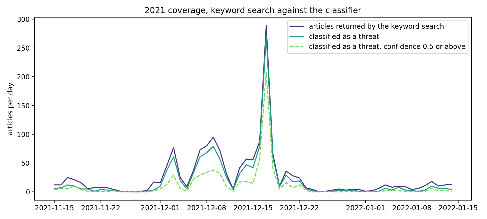
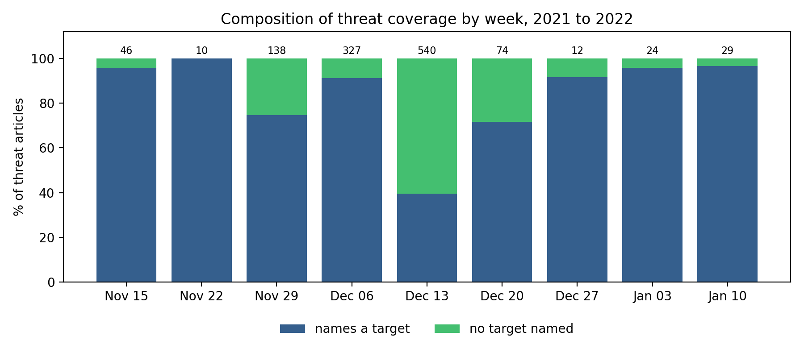

# Classifying and Comparing Viral School-Threat Trends on Social Media, 2016 to 2026

**DATA 5500, Senior Design**
**Student:** Sara Choque Molina
**Advisor:** Weijie Pang, PhD

This project studies how viral social media trends turn into threats against schools. It builds a classifier that separates news coverage of real student threats from coverage that uses similar words for something else, and uses it to measure how reliable keyword counts are as a way of tracking these trends.

The main case is the December 2021 TikTok school threat trend, from 15 November 2021 to 14 January 2022. The 2016 Killer Clown craze, the 2021 Devious Licks trend, the 2026 Cat in the Hat trend and the 2019 Momo scare, used as a control, give the comparison across periods. The classifier covers the 2021 TikTok case, where we collected the article text. The other periods are compared by their daily article counts. 

## Why a keyword count is not enough

A keyword search for school threats also returns articles about threats against school board members, pandemic closures and shootings with no threat behind them. The share of each period's results that the search itself tags as something other than a student threat:

| Case period | Articles | Student threats | Other |
|---|---|---|---|
| Killer Clown (Sep to Nov 2016) | 6,392 | 5,195 | 19% |
| TikTok trend (Nov 2021 to Jan 2022) | 4,995 | 4,266 | 15% |
| Devious Licks (Aug to Oct 2021) | 3,296 | 1,568 | 52% |
| Cat in the Hat (Aug to Sep 2026) | 1,356 | 1,148 | 15% |

Reading the articles goes further. Inside the bucket the search tags as student threats, the classifier finds that 84.55% of the readable articles are threats, so about one in six is something else.

## Research questions

| | Question | Answer |
|---|---|---|
| Q1 | Can a model sort coverage into targeted threats, nontargeted threats and unrelated articles? | Yes. TF-IDF with logistic regression reaches a Cohen's kappa of 0.676 over ten splits, and holds against five alternative models |
| Q2 | Which words carry the decision? | The trend vocabulary (`tiktok`, `social`, `media`, `challenge`) marks nontargeted threats, and a single named school marks targeted ones. `school` against `schools` carries that line by itself |
| Q3 | How did each trend start, peak and fade? | 2021 peaked at 10.1 times its normal level, 2016 at 3.1 and 2026 at 1.8 |
| Q4 | Are the trends lasting longer? | No. The longest runs above normal were 25, 25 and 17 days. The keyword error is larger on quiet days than at the peak, which points toward sharper waves |
| Q5 | Does the measure stay quiet when there is no threat? | Yes. The Momo control, viral but with no school threats, reached 1.5 times its normal level |

## Key results

**Labeling.** Three annotators labeled 136 articles under a written codebook, in two rounds. The model was then fitted on those 136 and used to label the remaining 1,418 articles of the 2021 corpus.

**Verification.** A stratified random sample of 50 predicted articles was read blind, with 8 repeated inside the sample to measure the reader's own consistency.

| | Accuracy | Kappa |
|---|---|---|
| Threat vs not a threat | 0.933 | 0.690 |
| Three labels | 0.756 | 0.585 |

The threat decision is the primary analysis. The split between targeted and nontargeted threats is a secondary one, reported with its lower reliability, which is itself a result: four separate measurements place the disagreement on that one line.

**The trend changes the coverage.** Outside the peak week, between 71.62% and 100% of threat articles name the school that was threatened. In the week of 13 December that share falls to 39.44%. Coverage moves from individual schools to the trend itself and returns the week after.





## Known limitations

- The 13 December drop in the targeted share may be partly driven by the model itself: the word `tiktok` pushes an article toward nontargeted, and that week's coverage is mostly about the TikTok trend. The targeted and nontargeted split is reported as secondary for this reason.
- `00_charts.ipynb` (early exploration) measures each period's normal level as the median of its own first third. `05_trends.ipynb` uses the same weeks in years with no trend. The peak multiples quoted for Q3 to Q5 come from `05_trends.ipynb`.
- Article text was downloaded from live web pages in 2026. Some links have since changed or disappeared, so rerunning `02_extract_text.ipynb` will not return exactly the same text.

## Data source

All article data comes from the GDELT Global Knowledge Graph, a free public database of online news, queried through Google BigQuery.

- Dataset: GDELT 2.0 on Google Cloud
- Table: `gdelt-bq.gdeltv2.gkg_partitioned`
- Field definitions: GKG 2.1 codebook

The dataset is public, so anyone with a Google account can run the queries in `queries/`.

## Repository structure

```
queries/          One .sql file per query, each with a header explaining what it does
data/raw/         Query results, and files that carry human labels
data/processed/   Files the notebooks produce, plus three hand-made label files (see data/raw/README.md)
notebooks/        Numbered notebooks, meant to be read in order
docs/             Codebook and the sheet used for the blind verification reading
figures/          Charts, each named after the notebook that makes it (05_..., 07_...)
```

`data/raw/` holds the BigQuery exports and the work people did by hand, such as the annotator sheets and the blind readings in `09_verification_sample.xlsx`. `data/raw/README.md` lists where every data file comes from.

## Notebooks

| Notebook | What it does |
|---|---|
| `00_charts.ipynb` | First look at the daily counts of all five periods (early exploration) |
| `link_test.py` | Script that tests how many article links still work, used to choose the main case. Run as `python link_test.py 02_articles_2021_tiktok.csv 300` |
| `02_extract_text.ipynb` | Downloads article text with Trafilatura |
| `03_clean.ipynb` | Cleans the corpus, from 4,995 links to 1,554 usable articles |
| `04_labeling.ipynb` | Builds the annotation set for the codebook |
| `05_trends.ipynb` | Daily counts against a seasonal baseline, Q3 to Q5 |
| `06_agreement_round2.ipynb` | Agreement between annotators across two rounds |
| `07_baseline.ipynb` | TF-IDF with logistic regression against the keyword search, Q1 |
| `08_advanced_model.ipynb` | Six candidate models on identical folds, with a shuffled label control |
| `09_labeling_verification.ipynb` | Labels the full corpus and verifies it against a blind reading |
| `10_keyword_vs_classified.ipynb` | Keyword search against the classifier: precision, wave shape, targeted share |
| `11_word_importance.ipynb` | Which words carry each decision, Q2 |

## How to reproduce

1. Install the packages: `pip install -r requirements.txt`
2. Open Jupyter inside the `notebooks/` folder. Each notebook finds its files in `data/raw/` and `data/processed/` on its own, and saves charts to `figures/`.
3. Run the notebooks in order, from `04_labeling.ipynb` onward. Every file they need is in the repository.
4. `02_extract_text.ipynb` downloads the article text from the web. Its output, `articles_2021_text.csv` (about 9 MB), is not in the repository, so run notebook 02 first if you want to rerun `03_clean.ipynb` from scratch. Its cleaned result, `articles_2021_clean.csv`, is included.
5. `08_advanced_model.ipynb` needs XGBoost and sentence-transformers and takes the longest to run.

To rebuild the raw data from scratch:

1. Open BigQuery with any Google account. The free sandbox is enough and needs no billing.
2. Run any file from `queries/`. Every query filters on `_PARTITIONTIME`, which keeps the scanned data inside the free monthly tier.
3. Save the result as CSV. The matching file in `data/raw/` shows the expected output.

## Tools

Python 3 with pandas, NumPy, scikit-learn, Trafilatura, langdetect, XGBoost, sentence-transformers and matplotlib, run in Jupyter on a laptop. The full list is in `requirements.txt`.
